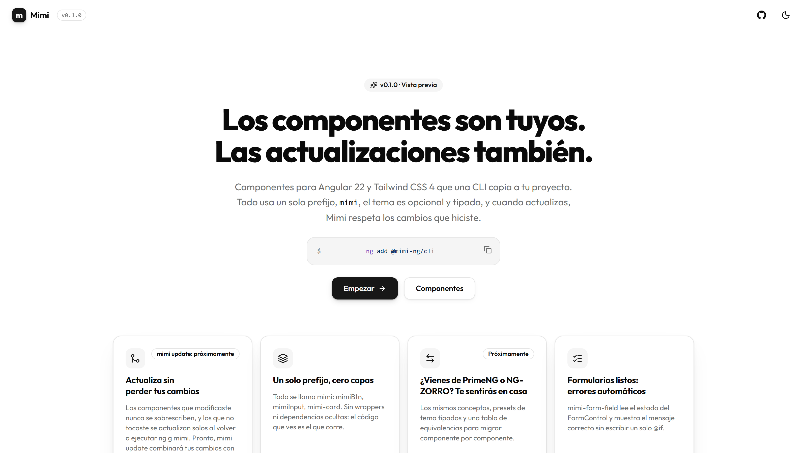

# Mimi para Angular

[](https://www.npmjs.com/package/@mimi-ng/cli)
[](https://github.com/nuki23/mimi-ng/blob/main/LICENSE)

> Angular + Tailwind CSS components you copy into your project. Docs in Spanish; English coming soon.

Componentes para **Angular** y **Tailwind CSS 4** que una CLI copia a tu proyecto: desde ese momento, el código es tuyo. Un solo prefijo (`mimi`), tema opcional y tipado, y formularios con errores automáticos.

Mimi nació como "lo mío". Su promesa es que sea tuyo.

**Vista previa 0.x:** la API puede cambiar entre versiones menores hasta la 1.0.

Documentación: **https://ng.mimiworks.dev**



## Requisitos

- Angular 22 o superior.
- Tailwind CSS 4. Para un proyecto nuevo: `ng new mi-app --style=tailwind`. Si tu proyecto ya existe, sigue la [guía de Tailwind CSS para Angular](https://tailwindcss.com/docs/installation/framework-guides/angular).
- Node.js `^22.22.3`, `^24.15.0` o `>=26` (los que exige Angular 22).

## Instalación

```sh
ng add @mimi-ng/cli
```

Verifica Angular y Tailwind (si falta algo, se detiene sin modificar nada) y configura el proyecto:

- importa el tema de Mimi en tu CSS global, justo después de `@import "tailwindcss"`, y excluye `.mimi/` del escaneo de Tailwind (`@source not "../.mimi";`, con Tailwind 4.1 o superior);
- agrega el alias `@/components/ui/*` al `tsconfig.json`;
- registra la CLI en `angular.json`, para que funcione `ng g mimi`;
- instala `clsx`, `tailwind-merge` y `class-variance-authority` con tu gestor de paquetes;
- crea `mimi.json` y la carpeta `.mimi/`.

Con `--icons` instala también [`@lucide/angular`](https://lucide.dev) para tus íconos.

**Si configuraste el CSS a mano, o instalaste con la 0.3.0 o una anterior,** agrega después de `@import "tailwindcss"` (la ruta va de tu CSS global a la carpeta `.mimi/` de la raíz; con `src/styles.css`, así):

```css
@source not "../.mimi";
```

Sin esa línea, Tailwind escanea las copias originales de `.mimi/` (van en git) y tu CSS lleva sus clases aunque ya las hayas cambiado. `ng g mimi` te avisa si falta. Necesita Tailwind 4.1 o superior: la 4.0 no entiende `@source not`.

## Agregar componentes

```sh
ng g mimi button              # uno
ng g mimi button input card   # varios a la vez
ng g mimi                     # menú para elegir (terminal interactiva)
ng g @mimi-ng/cli:ui button   # forma larga (si Mimi no está en schematicCollections)
```

Cada componente se copia a `src/app/components/ui/<nombre>`, con lo que necesite, y se instalan las dependencias que falten. Algunos usan por dentro `@angular/cdk` y `@angular/aria`, paquetes oficiales del equipo de Angular: `ng g mimi` los instala cuando hacen falta (aria en la versión exacta de tu cdk) y agrega los estilos del CDK a tu CSS global. Mimi necesita `@angular/cdk` y `@angular/aria` 22.2.4 o posterior (con 22.2.3, Combobox y Select pueden fallar al destruirse): si ya los tienes en una versión anterior, `ng g mimi` te avisa (no los cambia por ti); actualízalos con `ng update @angular/cdk @angular/aria`. Más en [Fundamentos](https://ng.mimiworks.dev/docs/foundations).

Después lo importas como cualquier otro:

```ts
import { MimiButton } from '@/components/ui/button';

@Component({
  selector: 'app-root',
  imports: [MimiButton],
  template: `<button mimiBtn>Hola, Mimi</button>`,
})
export class App {}
```

## Componentes

- **Avatar**: `ng g mimi avatar` · [documentación](https://ng.mimiworks.dev/docs/components/avatar)
- **Badge**: `ng g mimi badge` · [documentación](https://ng.mimiworks.dev/docs/components/badge)
- **Button**: `ng g mimi button` · [documentación](https://ng.mimiworks.dev/docs/components/button)
- **Card**: `ng g mimi card` · [documentación](https://ng.mimiworks.dev/docs/components/card)
- **Calendar**: `ng g mimi calendar` · [documentación](https://ng.mimiworks.dev/docs/components/date-picker)
- **Checkbox**: `ng g mimi checkbox` · [documentación](https://ng.mimiworks.dev/docs/components/switch)
- **Color Picker**: `ng g mimi color-picker` · [documentación](https://ng.mimiworks.dev/docs/components/color-picker)
- **Combobox**: `ng g mimi combobox` · [documentación](https://ng.mimiworks.dev/docs/components/combobox)
- **Command**: `ng g mimi command` · [documentación](https://ng.mimiworks.dev/docs/components/command)
- **Confirm**: `ng g mimi confirm` · [documentación](https://ng.mimiworks.dev/docs/components/confirm)
- **Context Menu**: `ng g mimi context-menu` · [documentación](https://ng.mimiworks.dev/docs/components/context-menu)
- **Data Table**: `ng g mimi data-table` · [documentación](https://ng.mimiworks.dev/docs/components/data-table)
- **Date Picker**: `ng g mimi date-picker` · [documentación](https://ng.mimiworks.dev/docs/components/date-picker)
- **Date Range**: `ng g mimi date-range` · [documentación](https://ng.mimiworks.dev/docs/components/date-range)
- **Dialog**: `ng g mimi dialog` · [documentación](https://ng.mimiworks.dev/docs/components/dialog)
- **Dropdown Menu**: `ng g mimi dropdown-menu` · [documentación](https://ng.mimiworks.dev/docs/components/dropdown-menu)
- **File Upload**: `ng g mimi file-upload` · [documentación](https://ng.mimiworks.dev/docs/components/file-upload)
- **FormField**: `ng g mimi form-field` · [documentación](https://ng.mimiworks.dev/docs/components/form-field)
- **Input**: `ng g mimi input` · [documentación](https://ng.mimiworks.dev/docs/components/input)
- **Input Mask**: `ng g mimi input-mask` · [documentación](https://ng.mimiworks.dev/docs/components/input-mask)
- **Input OTP**: `ng g mimi input-otp` · [documentación](https://ng.mimiworks.dev/docs/components/input-otp)
- **Number Input**: `ng g mimi number-input` · [documentación](https://ng.mimiworks.dev/docs/components/number-input)
- **Pagination**: `ng g mimi pagination` · [documentación](https://ng.mimiworks.dev/docs/components/pagination)
- **Password**: `ng g mimi password` · [documentación](https://ng.mimiworks.dev/docs/components/password)
- **Popover**: `ng g mimi popover` · [documentación](https://ng.mimiworks.dev/docs/components/popover)
- **Progress**: `ng g mimi progress` · [documentación](https://ng.mimiworks.dev/docs/components/progress)
- **Select**: `ng g mimi select` · [documentación](https://ng.mimiworks.dev/docs/components/select)
- **Separator**: `ng g mimi separator` · [documentación](https://ng.mimiworks.dev/docs/components/separator)
- **Skeleton**: `ng g mimi skeleton` · [documentación](https://ng.mimiworks.dev/docs/components/skeleton)
- **Slider**: `ng g mimi slider` · [documentación](https://ng.mimiworks.dev/docs/components/slider)
- **Sortable List**: `ng g mimi sortable-list` · [documentación](https://ng.mimiworks.dev/docs/components/sortable-list)
- **Switch**: `ng g mimi switch` · [documentación](https://ng.mimiworks.dev/docs/components/switch)
- **Tabs**: `ng g mimi tabs` · [documentación](https://ng.mimiworks.dev/docs/components/tabs)
- **Textarea**: `ng g mimi textarea` · [documentación](https://ng.mimiworks.dev/docs/components/input)
- **Tags Input**: `ng g mimi tags-input` · [documentación](https://ng.mimiworks.dev/docs/components/tags-input)
- **Toast**: `ng g mimi toast` · [documentación](https://ng.mimiworks.dev/docs/components/toast)
- **Toggle Group**: `ng g mimi toggle-group` · [documentación](https://ng.mimiworks.dev/docs/components/toggle-group)
- **Toolbar**: `ng g mimi toolbar` · [documentación](https://ng.mimiworks.dev/docs/components/toolbar)
- **Tooltip**: `ng g mimi tooltip` · [documentación](https://ng.mimiworks.dev/docs/components/tooltip)
- **Tree**: `ng g mimi tree` · [documentación](https://ng.mimiworks.dev/docs/components/tree)

## Blocks

Pantallas y secciones (inicio de sesión, registro, ajustes, precios…) hechas con los componentes de Mimi. Se agregan con el mismo comando, por ejemplo `ng g mimi` seguido del nombre del Block, y los componentes que usan van a la carpeta de siempre.

- **Las páginas** (`login-01`, `login-02`, `otp-01`, `settings-01`, `signup-01`) se generan como una página tuya: `ng g mimi login-01` crea `src/app/pages/login/` (`aliases.pages` en `mimi.json`) con `login.ts`, `login.html` y `login.routes.ts`, y la clase `LoginPage`. Al terminar te da la línea para `app.routes.ts` (la CLI no toca tus rutas). Otro nombre: `--name admin-login`. Si la carpeta ya existe, no la toca y te pide otro nombre.
- **Las secciones** (`pricing-01`) se copian a `src/app/blocks/<nombre>` (`aliases.blocks`): ponlas dentro de una de tus páginas.

El Block es tuyo; si lo modificas, `ng g mimi` no lo vuelve a tocar al actualizar (te avisa y `--overwrite` lo reemplaza entero). Mimi lo sigue por su nombre (`login-01`) aunque le pongas otro. Si instalaste una pantalla con la 0.4.0, sigue en `src/app/blocks/` y se actualiza ahí.

- **login-01** (página: inicio de sesión centrado, con Google y GitHub): `ng g mimi login-01` · [documentación](https://ng.mimiworks.dev/docs/blocks/login-01)
- **login-02** (página: inicio de sesión en dos columnas, con imagen y testimonio): `ng g mimi login-02` · [documentación](https://ng.mimiworks.dev/docs/blocks/login-02)
- **otp-01** (página: verificación con un código de 6 dígitos, reenvío y cuenta regresiva): `ng g mimi otp-01` · [documentación](https://ng.mimiworks.dev/docs/blocks/otp-01)
- **pricing-01** (sección: tres planes con mensual/anual y el plan destacado): `ng g mimi pricing-01` · [documentación](https://ng.mimiworks.dev/docs/blocks/pricing-01)
- **settings-01** (página: ajustes de cuenta con secciones, interruptores, sesiones y facturación): `ng g mimi settings-01` · [documentación](https://ng.mimiworks.dev/docs/blocks/settings-01)
- **signup-01** (página: registro con validación, medidor de contraseña y confirmación): `ng g mimi signup-01` · [documentación](https://ng.mimiworks.dev/docs/blocks/signup-01)

## Tus cambios

- Guarda la carpeta `.mimi/` en git: tiene la copia original de cada archivo, y con ella Mimi sabe qué cambiaste tú.
- Los componentes que modificaste nunca se sobrescriben: `ng g mimi` los omite con un aviso (`--overwrite` los reemplaza).
- Los que no tocaste se actualizan al volver a ejecutar `ng g mimi` con una versión nueva de la CLI.
- Próximamente: `mimi update`, para combinar tus cambios con la versión nueva.

## Si usas pnpm

Desde pnpm 10, los scripts de instalación de las dependencias están bloqueados hasta que los apruebes, y la instalación puede fallar con `ERR_PNPM_IGNORED_BUILDS`. Apruébalos con `pnpm approve-builds`. Más detalles en la [página de Instalación](https://ng.mimiworks.dev/docs/installation).

## Licencia

MIT. Incluye íconos de Lucide (ISC); ver `THIRD_PARTY_NOTICES.md`.

Mimi para Angular es un proyecto de [Mimi Works](https://mimiworks.dev).
